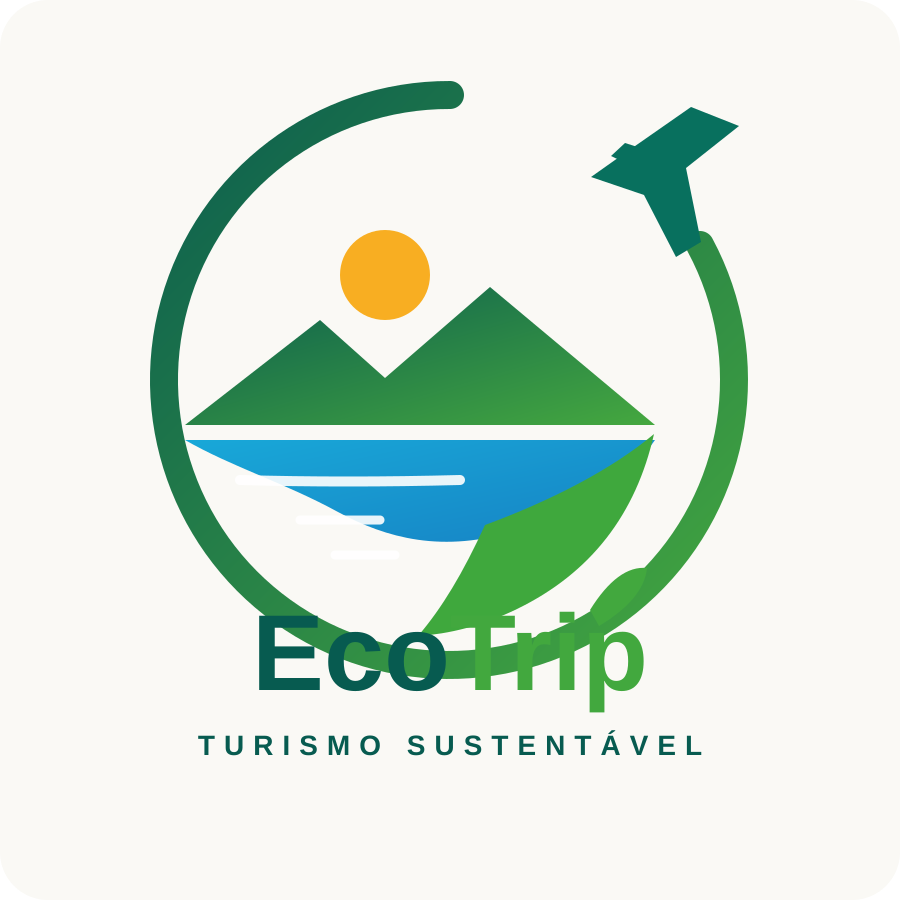
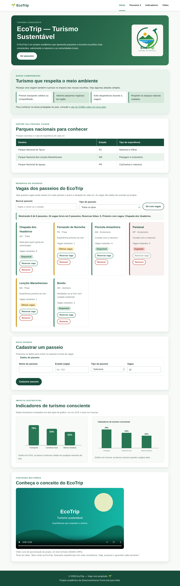
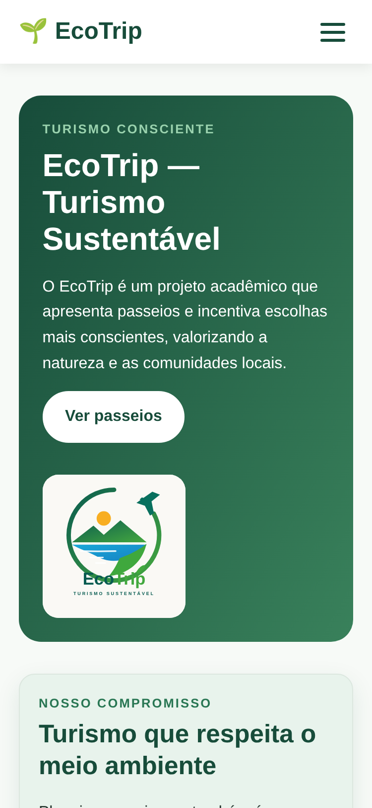
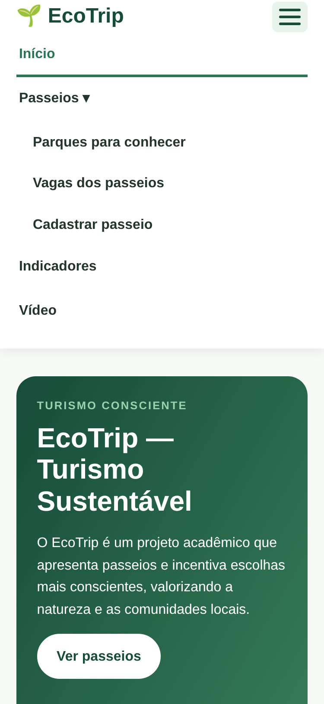
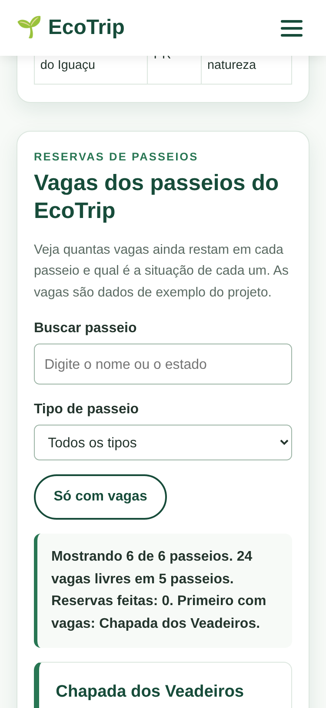

# 🌱 EcoTrip — Turismo Sustentável

<p align="center">
  
</p>

<p align="center"><strong>Projeto Integrador — Desenvolvimento Front-end para Web</strong></p>

O EcoTrip é um projeto acadêmico sobre turismo sustentável. A página apresenta passeios, mostra as vagas de cada um e traz dicas para viajar com mais consciência. O público são pessoas que querem conhecer lugares valorizando a natureza e as comunidades locais, e o objetivo é reunir em um só site tudo o que foi estudado nas aulas.

## 🛠️ Tecnologias

HTML5 · CSS3 · JavaScript puro · SVG · Canvas API · Git · GitHub

Não usei bibliotecas nem frameworks.

## 📸 Capturas de tela

**Desktop**

<p align="center">
  
</p>

**Celular**

<p align="center">
  
  
  
</p>

## 📁 Estrutura do projeto

```text
.
├── assets/
│   ├── images/
│   │   ├── captura-celular-menu.png
│   │   ├── captura-celular-passeios.png
│   │   ├── captura-celular.png
│   │   ├── captura-desktop.png
│   │   ├── logo-ecotrip.svg
│   │   └── poster-video.svg
│   └── video/
│       ├── guia-ecotrip.mp4
│       └── guia-ecotrip.webm
├── css/
│   ├── reset.css
│   └── style.css
├── js/
│   └── script.js
├── index.html
└── README.md
```

## ▶️ Como executar

1. Clone o repositório: `git clone https://github.com/isaac-cms/projeto-integrador-frontend-isaac-cardoso.git`
2. Abra a pasta e clique duas vezes no `index.html`, ou abra a pasta no VS Code e use a extensão Live Server.
3. Não precisa instalar nada. Para conferir, abra o console do navegador (F12): não deve aparecer nenhum erro.

## ✅ Mapa dos requisitos

Cada item da Seção 2 do documento de requisitos e onde ele foi atendido. As linhas valem para a versão final da `main`.

| Seção do PDF | Requisito | Onde foi atendido |
| --- | --- | --- |
| 2.1 | Repositório público com o nome pedido | Repositório `projeto-integrador-frontend-isaac-cardoso` no GitHub (público) |
| 2.1 | Pastas em minúsculas e sem espaços | Seção "Estrutura do projeto" deste README |
| 2.1 | Caminhos relativos e sem erro 404 | `index.html`, linhas 8–9 (CSS), 46 (imagem), 216–217 (vídeo) e 232 (script) |
| 2.1 | Commits convencionais, branches e Pull Requests | Aba **Commits** e aba **Pull Requests** do GitHub (`feat:`, `fix:`, `docs:`, `style:`, `refactor:`) |
| 2.1 | Versão final na `main` | Branch `main` do repositório |
| 2.1 | README completo | Este arquivo |
| 2.2 | Estrutura HTML5 válida | `index.html`, linhas 1–10 (`DOCTYPE`, `lang`, `charset`, `viewport`, `title`) |
| 2.2 | `h1` com o nome do projeto e parágrafo descritivo | `index.html`, linhas 42 (h1) e 43 (parágrafo) |
| 2.2 | Lista com 3+ itens | `index.html`, linhas 53–58 |
| 2.2 | Tabela com 2+ linhas e 2+ colunas | `index.html`, linhas 65–91 (3 parques nacionais reais) |
| 2.2 | Link externo com `target="_blank"` e `rel` | `index.html`, linha 59 |
| 2.2 | Imagem com `alt` descritivo | `index.html`, linha 46 |
| 2.2 | Semântica: `header`, `nav`, `main` único e `footer` | `index.html`, linhas 12–36 (header), 13–35 (nav), 38–225 (main) e 227–230 (footer) |
| 2.2 | 2+ `section` com título | `index.html`, 7 seções, cada uma com `h1` ou `h2`: linhas 39, 49, 62, 94, 126, 167 e 206 |
| 2.2 | Formulário: 4+ campos, `label`, `fieldset`/`legend`, `required`, `pattern` e `min`/`max` | `index.html`, linhas 131–164 (formulário), 142 (pattern), 158 (min e max) e 162 (botão) |
| 2.2 | Vídeo com 2 formatos, `preload` justificado e `poster` | `index.html`, linhas 215–219 (vídeo e poster) e 211–212 (comentário do preload) |
| 2.2 | `<track>` (opcional) | Não usei. O motivo está no comentário de `index.html`, linhas 213–214 |
| 2.2 | Gráfico em SVG e em Canvas com fallback | `index.html`, linhas 174–193 (SVG) e 198–200 (Canvas com texto alternativo); `js/script.js`, linhas 482–545 (animação do Canvas) |
| 2.2 | Canvas animado com `requestAnimationFrame()` e `clearRect()` | `js/script.js`, linhas 539 (requestAnimationFrame), 544 (requestAnimationFrame) e 499 (clearRect) |
| 2.3 | `css/reset.css` e `css/style.css` ligados, com `box-sizing: border-box` global | `index.html`, linhas 8–9 (os dois links); `css/reset.css`, linhas 6–10 (box-sizing) |
| 2.3 | 5+ variáveis CSS em `:root` | `css/style.css`, linhas 6–32 (18 variáveis de cor, espaçamento, tipografia e outras) |
| 2.3 | 3+ classes, 1 seletor de ID e 1 combinador | Classes como `.botao`, `.cartao` e `.secao`. Em `css/style.css`, linhas 395 (ID #lista-passeios), 146 (filho direto) e 67 (irmão adjacente) |
| 2.3 | Box model explícito | `css/style.css`, linhas 308 (comentário) e 405–412 (exemplo no .cartao) |
| 2.3 | Os 4 estados de link, na ordem | `css/style.css`, linhas 83–97 |
| 2.3 | Tabela e lista estilizadas | `css/style.css`, linhas 331–383 (border-collapse, padding e linhas alternadas) |
| 2.3 | `font-size` em `rem`, com justificativa | `css/style.css`, linhas 35–36 (comentário) |
| 2.3 | Navbar com Flexbox, `.ativo`, dropdown com `:hover`, `sticky` e botão hambúrguer | `css/style.css`, linhas 110 (sticky), 117–125 (navbar), 173 (.ativo), 180–197 (dropdown com :hover) e 212–220 (hambúrguer); HTML em `index.html`, linhas 13–35 |
| 2.3 | Grid com pseudo-classe estrutural e hover com `transform` | `css/style.css`, linhas 332–352 (grid e :nth-child), 399–403 (grade dos passeios), 296–299 (hover do botão) e 414–417 (hover do cartão) |
| 2.3 | Legível em celular e desktop | `css/style.css`, linhas 627–695 (@media) |
| 2.4 | Array com 5+ itens e 3+ propriedades | `js/script.js`, linhas 18–25 (6 passeios com 7 propriedades cada) |
| 2.4 | Comentário de planejamento no topo | `js/script.js`, linhas 1–14 (tema, entrada, processamento e saída) |
| 2.4 | Lógica (Aula 9): `if / else if / else`, `switch`, `for...of` com acumulador e `while` | `js/script.js`, linhas 73–81 (if / else if / else), 84–97 (switch), 100–110 (for...of) e 113–125 (while) |
| 2.4 | Funções e escopo (Aula 10): `return`, `Number()`, `const`/`let` e escopo local | `js/script.js`, linhas 58–69 (calcularVagasRestantes), 61–62 (Number()) e 64–66 (escopo local) |
| 2.4 | Arrays e DOM (Aula 11): `map`, `filter` e `reduce` | `js/script.js`, linhas 130–144 (map), 148–160 (filter) e 165 (reduce) |
| 2.4 | Elementos criados com `createElement`/`textContent` e marcados com classes | `js/script.js`, linhas 197–233 (criarItem), 226 (classes CSS) e 281 (inserção na lista) |
| 2.4 | Eventos (a): botão com `aria-expanded` e `aria-pressed`, que funciona pelo teclado | `js/script.js`, linhas 288–324 (menu com aria-expanded), 300–307 (Escape) e 338–342 (aria-pressed) |
| 2.4 | Eventos (b): delegação de eventos, também para itens criados depois | `js/script.js`, linhas 396–428 (um único ouvinte na lista) e 431–473 (itens novos pelo formulário) |
| 2.4 | Eventos (c): busca e filtro com `input` e `change` | `js/script.js`, linhas 328–352 |
| 2.4 | Eventos (d): resumo atualizado com `aria-live="polite"` | `js/script.js`, linhas 246–265 (escreverResumo); `index.html`, linha 119 (aria-live) |
| 2.4 | Eventos (e): nenhum `innerHTML` com texto digitado | `js/script.js`, linhas 197–233 (todo texto entra por textContent) e 196 (comentário) |
| 2.4 | Script no fim do `<body>` com `defer`, em um arquivo só | `index.html`, linha 232; um único `js/script.js` |
| 2.4 | Console sem erros | Ouvintes registrados uma única vez em `js/script.js`, linhas 549–554. Nenhuma mensagem de erro no console (F12) ao abrir o `index.html` |

## 👤 Autor

- **Nome:** Isaac Cardoso
- **RGM:** 47531568
- **Curso:** Análise e Desenvolvimento de Sistemas (2º período)

## 🌱 Sobre o EcoTrip

O EcoTrip é uma proposta de turismo sustentável que apresenta destinos e incentiva escolhas mais conscientes, valorizando a natureza e as comunidades locais.

**EcoTrip — Viaje com propósito. 🌱✈️**

Avaliação em pares - Avaliador: João Pedro Rodrigues Fabio

O projeto apresenta uma boa organização, utiliza corretamente as tags semânticas do HTML e demonstra uma boa aplicação de lógica de programação no JavaScript, com validações, condicionais e estruturas de repetição. A estrutura está coerente com a proposta e apresenta funcionalidades interessantes.

Minha avaliação: o projeto atende a boa parte dos requisitos, com uma estrutura bem organizada e uma lógica funcional.
